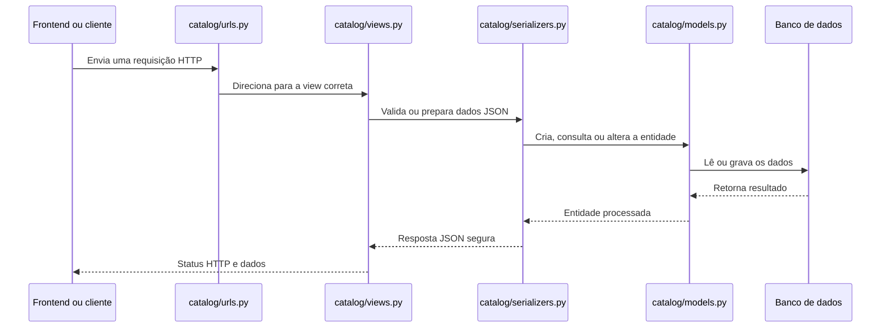

# Guia do futuro CRUD de catálogo

Este guia explica como o app `backend/catalog/` será usado quando a equipe iniciar as funcionalidades de categorias, produtos e cardápio. Ele é um mapa de trabalho: a estrutura existe, mas os requisitos de campos, regras e endpoints ainda precisam ser definidos pela próxima task.

## O que é CRUD

CRUD representa as quatro operações principais sobre dados:

| Operação | Significado | HTTP mais comum | Exemplo futuro |
| --- | --- | --- | --- |
| Create | Criar | `POST` | Cadastrar uma categoria ou produto. |
| Read | Consultar | `GET` | Listar produtos ou consultar um produto. |
| Update | Atualizar | `PUT` ou `PATCH` | Alterar dados de um produto. |
| Delete | Excluir | `DELETE` | Remover ou desativar um produto, conforme a regra definida. |

O CRUD não será criado de uma vez. A ordem recomendada é definir as entidades, criar os modelos, gerar migrações, validar os dados e então disponibilizar os endpoints com testes.

## Papel de cada arquivo

| Arquivo em `backend/catalog/` | Responsabilidade futura |
| --- | --- |
| `models.py` | Define entidades do banco e relacionamentos. Categoria e Produto serão definidos aqui depois que os campos forem aprovados. |
| `serializers.py` | Valida os dados JSON que chegam e define os dados seguros que a API devolve. |
| `views.py` | Recebe as requisições HTTP e escolhe a operação adequada. Pode usar views genéricas do DRF ou views próprias. |
| `urls.py` | Associa endereços da API às views. Hoje o arquivo existe, mas ainda não tem rotas. |
| `services.py` | Guarda regras de negócio que não devem ficar misturadas nas views, como uma operação que atualiza mais de um registro. |
| `permissions.py` | Centraliza regras de acesso específicas do catálogo. |
| `admin.py` | Configura o painel Django Admin para facilitar consulta e administração interna. |
| `migrations/` | Guarda o histórico de alterações de banco gerado pelo Django. Não editar migrações já compartilhadas. |
| `tests.py` | Testa comportamento esperado: sucesso, validação e bloqueio de acesso. |

## Fluxo de uma requisição



Em operações com uma regra mais complexa, a view chama uma função em `services.py`. A service coordena a regra e usa modelos; ela não substitui a view nem o serializer.

## Exemplo conceitual de criação

Sem definir campos reais, o caminho de uma criação será:

```text
Cliente envia POST com dados de produto
→ URL aponta para a view de criação
→ serializer valida os dados definidos pela equipe
→ model salva no banco
→ serializer devolve a resposta sem dados indevidos
```

O mesmo padrão vale para consulta, alteração e exclusão: a URL encontra a view, a view usa serializer quando há dados JSON, e o model é a camada que conversa com o banco.

## Onde cada pessoa deve programar

- Campos, relações e validações diretamente ligadas ao banco: `models.py`.
- Regras de formato e validação de entrada/saída da API: `serializers.py`.
- Endpoints e resposta HTTP: `views.py` e `urls.py`.
- Regra reutilizável ou transacional: `services.py`.
- Controle de quem acessa uma ação: `permissions.py`.
- Cenários de verificação: `tests.py`.

Antes de começar, a issue deve definir o objetivo e os critérios de aceite. Depois de alterar um modelo, a pessoa responsável gera e inclui uma nova migração.

## O que ainda é placeholder

O app `catalog` ainda não possui:

- modelos ou campos de Categoria e Produto;
- serializer com validações reais;
- endpoint, rota de CRUD ou cardápio público;
- regra de disponibilidade, preço, imagem, estoque ou ficha técnica;
- permissões específicas;
- migração de catálogo ou testes de catálogo.

Essas ausências são intencionais: evitam que o projeto assuma regras sem acordo da equipe.

## Autenticação e permissões depois

O backend já usa JWT por padrão. Quando as views do catálogo existirem:

- a gestão interna de categorias e produtos exigirá token válido e perfil permitido;
- a visualização do cardápio público deverá declarar acesso aberto explicitamente;
- a permission será conferida no backend, não apenas por telas ou botões do frontend;
- as regras de perfil poderão ficar em `catalog/permissions.py` ou reutilizar regras de `users/`.

O perfil e a matriz de permissões ainda serão definidos na task de autorização local. Até lá, não há decisão implementada sobre qual perfil poderá executar cada operação.

## Checklist da primeira implementação

1. Definir campos e regras de Categoria e Produto.
2. Criar os modelos em `models.py`.
3. Gerar e revisar migrações.
4. Criar serializers e testes de validação.
5. Criar views e URLs para a primeira operação escolhida.
6. Aplicar autenticação e permissão adequadas.
7. Criar testes de sucesso, erro e acesso negado.
8. Dentro de `backend/`, executar `python manage.py check` e `python manage.py test`.
