# Guia de apresentação técnica: PL Lanchonete & Pastelaria (ERP)

Foco: **o que cada funcionalidade faz, que problema resolve e onde está no código**.
Os caminhos com `arquivo:linha` abrem direto no editor. Teoria fica de fora.

- Sistema: `https://pllanchonete.tailc962e7.ts.net`
- Banco (somente leitura): `https://pllanchonete.tailc962e7.ts.net/db/` (consultas em [QUERIES_BANCA.md](QUERIES_BANCA.md))
- Usuários da demo: `cliente`, `atendente`, `cozinheiro` e `entregador`, todos com a senha `demo1234`

---

## 1. Visão geral em 30 segundos

| Camada | Tecnologia | Papel |
|---|---|---|
| Apresentação | Next.js (React), PWA | Telas por perfil: cliente, PDV/gestão, cozinha, entregador, admin |
| Borda | Caddy + Tailscale Funnel | HTTPS público e roteamento: `/api` vai para o Django, o resto para o Next |
| Aplicação | Django + Django REST Framework | Regras de negócio, permissões, API REST, autenticação JWT |
| Dados | PostgreSQL | Persistência com integridade: 28 FKs, 18 regras de unicidade, 4 CHECKs |

```
Celular/Notebook ──HTTPS──> Funnel ──> Caddy ──┬─ /api, /admin ──> Django (gunicorn) ──> PostgreSQL
                                               ├─ /media ───────> arquivos (fotos, logo)
                                               ├─ /db ──────────> pgweb (leitura)
                                               └─ resto ────────> Next.js
```

Roteamento em [infrastructure/Caddyfile:33](../infrastructure/Caddyfile:33). Containers em [docker-compose.prod.yml](../docker-compose.prod.yml).

---

## 2. DER (modelo de dados real)

Gerado a partir das chaves estrangeiras do banco em produção. Os campos mostram o essencial de cada tabela.

```mermaid
erDiagram
    auth_user ||--|| users_perfil : "tem perfil (role)"
    users_permissao ||--o{ users_rolepermissao : "concedida a role"

    catalog_categoria ||--o{ catalog_produto : agrupa
    catalog_produto ||--o{ inventory_receitaitem : "ficha técnica"
    inventory_insumo ||--o{ inventory_receitaitem : "compõe"
    inventory_insumo ||--o{ inventory_movimentacao : "entrada/saída"
    auth_user ||--o{ inventory_movimentacao : responsável

    auth_user ||--o{ orders_pedido : "cliente"
    auth_user |o--o{ orders_pedido : "entregador"
    auth_user |o--o{ orders_pedido : "cancelado por"
    orders_pedido ||--|{ orders_itempedido : contém
    catalog_produto ||--o{ orders_itempedido : "vendido em"
    orders_pedido ||--o| orders_enderecopedido : "entrega em"
    orders_pedido ||--o| preparation_preparo : "fila da cozinha"
    orders_pedido ||--o| finance_lancamento : "gera receita"

    finance_financecategory ||--o{ finance_lancamento : classifica
    auth_user ||--o{ finance_lancamento : "recebeu"
    auth_user ||--o{ rh_turno : trabalha
    auth_user ||--o{ rh_auditoria : "executou"

    auth_user {
        int id PK
        string username UK
        string email
        string first_name
    }
    users_perfil {
        int id PK
        int user_id FK,UK
        string role "cliente|atendente|cozinheiro|entregador|administrador"
        bool is_online
        string telefone
        string cep_logradouro_numero_bairro_cidade_uf
    }
    users_permissao {
        int id PK
        string codigo UK "ex.: CANCELAR_PEDIDO"
        string modulo
    }
    users_rolepermissao {
        int id PK
        string role_nome
        int permissao_id FK
    }
    catalog_categoria {
        int id PK
        string nome UK
    }
    catalog_produto {
        int id PK
        string nome UK
        decimal preco
        bool disponibilidade
        string imagem
        int categoria_id FK
    }
    inventory_insumo {
        int id PK
        string nome UK
        string unidade_medida
        decimal quantidade_atual "CHECK >= 0"
        decimal estoque_minimo
    }
    inventory_receitaitem {
        int id PK
        int produto_id FK
        int insumo_id FK
        decimal quantidade_necessaria
    }
    inventory_movimentacao {
        int id PK
        int insumo_id FK
        string tipo "ENTRADA|SAIDA"
        decimal quantidade
        string motivo "COMPRA|BAIXA|PERDA|DEVOLUCAO"
        int responsavel_id FK
    }
    orders_pedido {
        int id PK
        string status "máquina de estados"
        string tipo_atendimento "balcao|mesa|delivery|retirada"
        decimal total
        string payment_method
        decimal valor_recebido
        decimal troco
        string codigo_pin_entrega
        int tentativas_pin "CHECK >= 0"
        text comprovante_entrega_url
        int cliente_id FK
        int entregador_id FK
    }
    orders_itempedido {
        int id PK
        int pedido_id FK
        int produto_id FK
        int quantidade "CHECK >= 0"
        decimal preco_unitario
    }
    orders_enderecopedido {
        int id PK
        int pedido_id FK,UK
        string cep
        string logradouro
        string uf
    }
    preparation_preparo {
        int id PK
        int pedido_id FK,UK
        string status
        datetime started_at
        datetime finished_at
    }
    finance_lancamento {
        int id PK
        int pedido_id FK,UK "1 receita por pedido"
        string type "receita|despesa"
        decimal value
        string payment_method
    }
    finance_financecategory {
        int id PK
        string name UK
        string type
    }
    rh_turno {
        int id PK
        int user_id FK
        datetime inicio
        datetime fim
        decimal saldo_dinheiro
    }
    rh_auditoria {
        int id PK
        int user_id FK
        string acao
        string entidade
        int entidade_id
        text detalhes
    }
```



`sys_configuracao` (chave e valor) fica fora do diagrama porque não tem relacionamentos. Ela guarda as regras da loja: taxa de entrega, pedido mínimo, se aceita pedidos pelo app e o limite de entregas por entregador.

**O que dizer sobre o modelo:**
- **Pedido é o centro:** dele saem os itens, o endereço, o preparo e a receita. Os três últimos são 1:1, garantidos por `UNIQUE (pedido_id)`, então um pedido nunca gera duas receitas.
- **Ficha técnica (`receitaitem`)** é a ponte N:N entre produto e insumo. É ela que transforma "vendi 2 X-Burger" em "saíram 2 pães, 2 hambúrgueres e 2 fatias de queijo".
- **Estoque por movimentação:** o saldo do insumo nunca é editado na mão. Toda mudança vira uma linha em `movimentacao`, o que deixa histórico completo.
- **Um usuário, vários papéis no pedido:** a mesma tabela `auth_user` aparece como cliente, entregador e quem cancelou. O perfil (`users_perfil.role`) define o que cada um pode fazer.

---

## 3. Funcionalidades: problema, como funciona, código

### 3.1 Pedido com máquina de estados

- **Problema que resolve:** pedido pulando etapa (entregue sem ter sido preparado, pago duas vezes, cancelado depois de faturado).
- **Como funciona:** um dicionário define as únicas transições permitidas. Toda mudança de status, venha da tela que vier, passa por uma função só.
- **Código:**
  - Transições permitidas: [backend/orders/services.py:15](../backend/orders/services.py:15)
  - Validação: [backend/orders/services.py:36](../backend/orders/services.py:36)
  - Função central `transicionar_status`: [backend/orders/services.py:118](../backend/orders/services.py:118)

```python
TRANSICOES_VALIDAS = {
    'criado': {'confirmado', 'cancelado'},
    'confirmado': {'em_preparo', 'pronto', 'finalizado', 'cancelado'},
    'em_preparo': {'pronto', 'finalizado', 'cancelado'},
    'pronto': {'entregue', 'retornando_base', 'finalizado', 'cancelado'},
    ...
}
```

**Para falar:** "Qualquer tela que muda o status (gestão, cozinha, entregador, pagamento) chama a mesma função. Ela valida a transição e executa tudo dentro de uma transação: se algo falha no meio, nada é gravado."

### 3.2 Baixa automática de estoque pela ficha técnica

- **Problema que resolve:** estoque controlado no caderno e ingrediente que acaba no meio do expediente.
- **Como funciona:**
  1. Ao **confirmar** o pedido, o sistema soma os insumos da ficha de cada item, multiplicados pela quantidade.
  2. Trava as linhas desses insumos no banco e confere se há saldo.
  3. Cria uma movimentação de **saída** para cada insumo.
  4. Um *signal* atualiza o saldo de forma atômica.
- **Código:**
  - Soma pela ficha: `calcular_insumos`, em [backend/orders/services.py:55](../backend/orders/services.py:55)
  - Trava e confere o saldo: `verificar_estoque`, em [backend/orders/services.py:66](../backend/orders/services.py:66)
  - Grava as saídas: `debitar_estoque`, em [backend/orders/services.py:86](../backend/orders/services.py:86)
  - Atualiza o saldo: [backend/inventory/signals.py](../backend/inventory/signals.py)

```python
# verificar_estoque: bloqueia as linhas dos insumos até o fim da transação
atuais = {i.pk: i for i in Insumo.objects.select_for_update().filter(pk__in=[...])}
if disponivel < qtd:
    raise ValidationError(f'Estoque insuficiente para o insumo: {insumo.nome}...')

# signals.py: o saldo muda dentro do banco, sem ler-e-gravar no Python
Insumo.objects.filter(pk=instance.insumo_id).update(
    quantidade_atual=F('quantidade_atual') - instance.quantidade)
```

**Para falar (concorrência):** "Se dois atendentes confirmam pedidos ao mesmo tempo disputando o último pão, o `select_for_update` faz o segundo esperar o primeiro terminar. Ele então vê o saldo já descontado e recebe 'estoque insuficiente'. A última linha de defesa é o banco: a regra `CHECK (quantidade_atual >= 0)` recusa saldo negativo mesmo se o código falhar." Essa regra está em [backend/inventory/models.py:38](../backend/inventory/models.py:38).

- **Cancelamento:**
  - Cancelado **antes** do preparo, os insumos voltam ao estoque como movimentação de entrada.
  - Cancelado **depois** do preparo, conta como perda, a menos que o operador marque a devolução.
  - Código: [backend/orders/services.py:157](../backend/orders/services.py:157)

### 3.3 Fila da cozinha (preparo)

- **Problema que resolve:** comanda de papel perdida e cozinha sem ordem de chegada.
- **Como funciona:**
  - Confirmar o pedido cria um registro em `preparation_preparo` (status `pendente`).
  - Cada avanço do pedido sincroniza o status do preparo.
  - A tela da cozinha consulta a API a cada **4 segundos**.
- **Código:**
  - Sincronização do preparo: [backend/orders/services.py:194](../backend/orders/services.py:194)
  - Polling da cozinha: [frontend/app/cozinha/page.tsx:74](../frontend/app/cozinha/page.tsx:74), com `refreshInterval: 4000`

### 3.4 Pagamento, troco e receita automática

- **Problema que resolve:** caixa que não bate e venda que não entra no financeiro.
- **Como funciona:**
  1. O atendente informa a forma de pagamento e o valor recebido.
  2. O **troco é calculado no servidor**, nunca aceito da tela.
  3. Ao finalizar, a receita é criada no financeiro, ligada ao pedido.
- **Código:**
  - Validação do pagamento e cálculo do troco: [backend/orders/views.py:114](../backend/orders/views.py:114)
  - Criação da receita: `criar_receita_para_pedido`, em [backend/finance/services.py:10](../backend/finance/services.py:10)

```python
if valor_recebido < pedido.total:
    raise ValidationError({'valor_recebido': f'Valor insuficiente. Total do pedido: R$ {pedido.total}'})
troco = valor_recebido - pedido.total   # calculado no servidor
...
transicionar_status(pedido, 'finalizado', responsavel=request.user)  # cria a receita
```

- **Sem receita duplicada, em duas camadas:**
  - O código verifica `hasattr(pedido, 'lancamento_financeiro')` antes de criar.
  - O banco tem `UNIQUE (pedido_id)` em `finance_lancamento`.
  - Se o pedido for cancelado, a receita é estornada.

### 3.5 App do cliente (PWA) e Minha conta

- **Problema que resolve:** pedido por telefone ou WhatsApp anotado errado. O cliente pede sozinho, com o endereço já salvo.
- **Como funciona:**
  - O cardápio vem da API, com fotos.
  - O carrinho fica no navegador.
  - O CEP preenche o endereço automaticamente pela ViaCEP.
  - O pedido nasce com status `criado` e espera o aceite da loja.
  - O servidor aplica as regras da loja: se aceita pedidos pelo app e qual o pedido mínimo.
- **Código:**
  - Regras da loja no pedido do app: [backend/orders/views.py:42](../backend/orders/views.py:42). O cliente **não** escolhe entregador nem informa valor recebido; o servidor força esses campos.
  - Minha conta, edição dos próprios dados: [backend/users/views.py](../backend/users/views.py), `MeView.patch`, e `MinhaContaSerializer` em [backend/users/serializers.py](../backend/users/serializers.py)
  - Tela da conta: [frontend/components/cliente/MinhaConta.tsx](../frontend/components/cliente/MinhaConta.tsx)
  - Instalável como app (PWA): manifesto em [frontend/app/manifest.webmanifest/route.ts](../frontend/app/manifest.webmanifest/route.ts)

**Para falar (segurança):** "O cliente só vê os próprios pedidos: o `get_queryset` filtra por `cliente=request.user`. Na Minha conta ele edita nome, e-mail, telefone e endereço, mas não o perfil. O campo `role` simplesmente não existe no serializer de edição, então não há como se promover a administrador."

### 3.6 Entrega com PIN, assinatura e falha

- **Problema que resolve:** "o pedido não chegou" sem prova, e entregador marcando entrega sem ter entregue.
- **Como funciona:**
  1. Ao atribuir o entregador, o sistema gera um **PIN de 4 dígitos**. Só o cliente recebe esse PIN.
  2. Na entrega, o entregador digita o PIN que o cliente informar, ou coleta a **assinatura com o dedo**, salva como imagem.
  3. Depois de **5 PINs errados**, a confirmação por PIN bloqueia.
  4. Se o cliente estiver ausente, o entregador registra a falha, e o pedido volta para a loja reenviar.
- **Código:**
  - Atribuição do entregador, com limite de entregas simultâneas e geração do PIN: [backend/orders/views.py:337](../backend/orders/views.py:337)
  - Confirmação da entrega, com bloqueio e comparação segura: [backend/orders/views.py:393](../backend/orders/views.py:393)
  - Assinatura no canvas: [frontend/app/entregador/page.tsx:212](../frontend/app/entregador/page.tsx:212)
  - Navegação: Waze em [frontend/app/entregador/page.tsx:190](../frontend/app/entregador/page.tsx:190) e Google Maps em [:195](../frontend/app/entregador/page.tsx:195)

```python
pedido.codigo_pin_entrega = f'{secrets.randbelow(10000):04d}'   # aleatório criptográfico
...
if pedido.tentativas_pin >= MAX_TENTATIVAS_PIN:
    raise PermissionDenied('PIN bloqueado por excesso de tentativas. Procure a loja.')
if not hmac.compare_digest(pin_informado, pedido.codigo_pin_entrega or ''):
    pedido.tentativas_pin += 1
```

**Para falar:** "Usamos `secrets`, e não `random`, porque o PIN precisa ser imprevisível. Usamos `hmac.compare_digest` porque compara em tempo constante: quem tenta adivinhar não descobre dígitos pelo tempo de resposta. O limite de 5 tentativas impede o chute de todas as 10 mil combinações."

### 3.7 Controle de acesso por perfil (RBAC)

- **Problema que resolve:** cozinheiro mexendo no financeiro e cliente acessando a gestão.
- **Como funciona:**
  - **Três camadas:**
    1. No servidor Next (`proxy.ts`), antes da página carregar.
    2. No navegador (`AuthGuard`), sem a tela proibida aparecer, nem por um instante.
    3. Na **API**, que é a camada que vale de verdade.
  - **Permissões granulares** (ex.: `CANCELAR_PEDIDO`) ficam no banco e são editáveis pelo admin na tela de Permissões.
- **Código:**
  - Proxy do Next: [frontend/proxy.ts:21](../frontend/proxy.ts:21)
  - Guarda de rotas no navegador: [frontend/components/auth/AuthGuard.tsx:35](../frontend/components/auth/AuthGuard.tsx:35)
  - Checagem de permissão na API: `tem_permissao`, em [backend/users/permissions.py:79](../backend/users/permissions.py:79)
  - Uso real, só quem tem `CANCELAR_PEDIDO` cancela: [backend/orders/views.py:87](../backend/orders/views.py:87)

**Para falar:** "As camadas do frontend são conveniência, para o usuário não ver tela que não pode usar. A garantia é a API: mesmo chamando o endpoint direto, sem o site, o servidor recusa com 403."

### 3.8 Autenticação JWT resiliente

- **Problema que resolve:** cair a internet por um instante e o sistema deslogar todo mundo no meio do expediente.
- **Como funciona:**
  - O login devolve um token de acesso de 5 minutos e um de renovação de 1 dia.
  - Quando o acesso expira, o front renova sozinho.
  - Em **erro de rede**, a sessão é mantida e o front tenta de novo. Só um 401/403 real do servidor desloga.
- **Código:**
  - Renovação do token: [frontend/services/api.ts](../frontend/services/api.ts), `refreshAccessToken` e o interceptor
  - Novas tentativas e manutenção da sessão: [frontend/contexts/AuthContext.tsx](../frontend/contexts/AuthContext.tsx), `fetchCurrentUser`

### 3.9 Turno e acerto de caixa do entregador

- **Problema que resolve:** dinheiro recebido na rua sem conferência.
- **Como funciona:**
  - Ao iniciar o turno, o entregador fica **online** e pode receber entregas.
  - Ao encerrar, o sistema soma os pedidos pagos em **dinheiro** que ele entregou no período.
  - Esse valor é o que ele deve devolver ao caixa.
- **Código:**
  - Início do turno: `iniciar_turno`, em [backend/core/services.py:21](../backend/core/services.py:21)
  - Fechamento com cálculo do dinheiro: `encerrar_turno`, em [backend/core/services.py:45](../backend/core/services.py:45)

### 3.10 Rotinas automáticas (RPA) e auditoria

- **Problema que resolve:** tarefas de conferência que ninguém faz no fim do dia.
- **As três rotinas:**
  - **rpa-01:** garante que todo pedido em andamento esteja na fila da cozinha.
  - **rpa-02:** lista os insumos em nível crítico.
  - **rpa-03:** concilia o caixa do dia por forma de pagamento e aponta divergência com o dinheiro dos turnos.
- **Evidência:** toda rotina grava o resultado na **auditoria**.
- **Código:**
  - As três rotinas: [backend/core/services.py:149](../backend/core/services.py:149) até a 235
  - Registro de auditoria: `registrar_auditoria`, em [backend/core/services.py:7](../backend/core/services.py:7)
  - Painel do admin: [frontend/components/dashboard/RpaRoutines.tsx](../frontend/components/dashboard/RpaRoutines.tsx)

**No banco:** a consulta 6 de [QUERIES_BANCA.md](QUERIES_BANCA.md) mostra cada ação com usuário e horário: cancelamentos, turnos e rotinas RPA.

### 3.11 Identidade visual a partir de um upload

- **Problema que resolve:** cada loja com a própria marca sem mexer em código.
- **Como funciona:** o admin envia a logo uma única vez. O servidor gera a logo do cabeçalho, a versão preto e branco do cupom, o favicon e os ícones do app nos tamanhos 192 e 512.
- **Código:** `salvar_logo`, em [backend/core/branding.py:71](../backend/core/branding.py:71)

### 3.12 Erros tratados e infraestrutura

- **Erro de validação:** vira resposta HTTP 400 com mensagem legível, em vez de erro 500. Código: [backend/config/exceptions.py:12](../backend/config/exceptions.py:12)
- **Cabeçalhos de segurança no Caddy:** HSTS, `X-Frame-Options` e `nosniff`.
- **CI no GitHub a cada push:**
  - 219 testes, com cobertura mínima de 80%;
  - Bandit (segurança do código);
  - pip-audit (dependências);
  - build do frontend.

---

## 4. Roteiro de demonstração (com o que mostrar no código)

| # | Ação na tela | Onde | Mostrar no código | Mostrar no banco (QUERIES_BANCA) |
|---|---|---|---|---|
| 1 | Cliente faz pedido delivery | Notebook, `/cliente` | `perform_create` (3.5) | Consulta 1: pedido `criado` |
| 2 | Atendente aceita | Notebook, `/gestao` | `transicionar_status` e `verificar_estoque` (3.1, 3.2) | Consultas 3 e 4: estoque baixou |
| 3 | Cozinha prepara e marca pronto | Notebook, `/cozinha` | Fila e polling (3.3) | Consulta 1: `em_preparo` e depois `pronto` |
| 4 | Atendente atribui entregador | Notebook, `/gestao` | Geração do PIN (3.6) | Consulta 9 |
| 5 | Entregador erra o PIN e depois acerta | iPhone | `compare_digest` e `tentativas_pin` (3.6) | Consulta 9: tentativas |
| 6 | Pagamento e finalização | Notebook | Troco no servidor e receita (3.4) | Consulta 5: receita do pedido |
| 7 | Tentar abrir `/finance` como cozinheiro | Notebook | RBAC (3.7) | Não se aplica |
| 8 | Rodar o RPA de estoque crítico | Admin | `executar_rpa` (3.10) | Consulta 6: auditoria |

---

## 5. Perguntas prováveis da banca

| Pergunta | Resposta curta | Onde está |
|---|---|---|
| E se dois pedidos usarem o último ingrediente ao mesmo tempo? | `select_for_update` serializa as confirmações, e o CHECK do banco impede saldo negativo | 3.2 |
| Como garante que um pedido não é cobrado duas vezes? | A máquina de estados não deixa voltar de `finalizado`, e há `UNIQUE (pedido_id)` no lançamento | 3.1 e 3.4 |
| O cliente pode alterar o preço ou o troco pela requisição? | Não. O total é recalculado dos itens no servidor e o troco é calculado no servidor | 3.4 |
| Como sabe que foi entregue? | PIN que só o cliente tem, ou assinatura salva como imagem no pedido | 3.6 |
| Como impede acesso indevido? | RBAC em 3 camadas; a API é a garantia | 3.7 |
| Por que tem cancelamento que não devolve estoque? | Depois do preparo o ingrediente já foi usado e conta como perda, a menos que o operador marque a devolução | 3.2 |
| Como sabem quem fez o quê? | Tabela de auditoria, gravada pelas regras de negócio | 3.10 |
| Como foi testado? | 219 testes automatizados em CI, com cobertura mínima de 80% | 3.12 |
